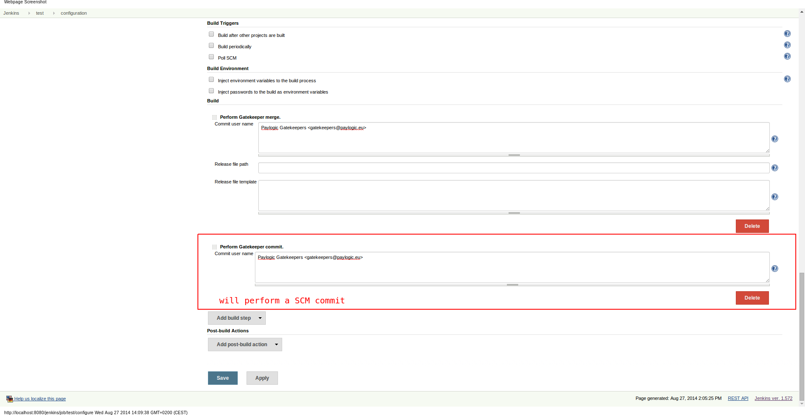
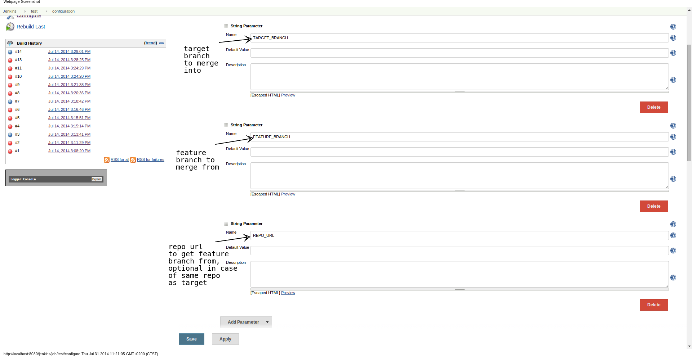
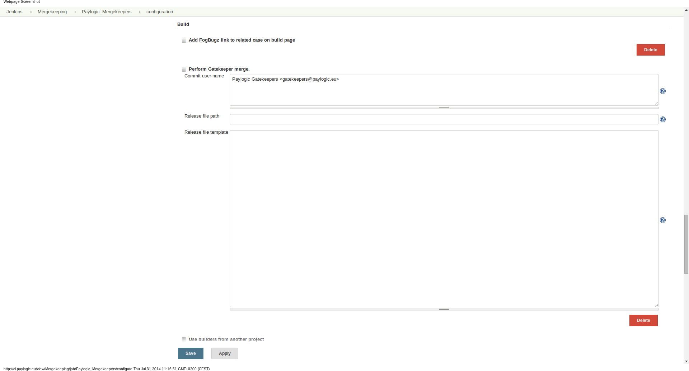
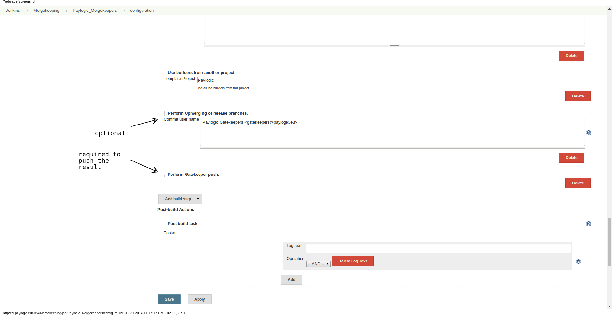

# Gatekeeper Plugin

Plugin that implements 'Gatekeeper' development workflow including:

- Create release branches with optional release (version) file generation
- Performs Gatekeepering by merging 'feature' branches with 'release' branches
- Provides ability to upmerge release branches between each other to propagate changes from lower release to higher one.

Plugin provides such build steps:

- Perform Gatekeeper merge
- Perform Gatekeeper commit
- Perform Upmerging of release branches
- Perform Push

To activate this plugin, configure your job with "Perform Gatekeeper commit." build step.

## Configuration and results

*Commit build step configuration*

*Build parameters configuration*

*Merge build step configuration*

*Upmerge and push build steps configuration*

Plugin works nicely together with [Fogbugz plugin](https://plugins.jenkins.io/fogbugz) so if you use Fogbugz as an issue tracker, it can simplify a lot your workflow with this plugin.

Please also check [this article](http://developer.paylogic.com/articles/codereview.html).

## Changelog

### Version 3.0.2 (Aug 27, 2014)

- Split up gatekeeper commit as separate build action

### Version 2.0.22 (Aug 27, 2014)

- Restored behavior of cleaning working copy before the merge

### Version 2.0.21 (Jul 21, 2014)

- Major refactoring and bug fixes

### Version 2.0.14 (Jun 6, 2014)

- Major refactoring and bug fixes
- Added git support
- Implemented automatic release branch creation with release file generation

### Version 2.0.0 (Jan 17, 2014)

- Initial release
